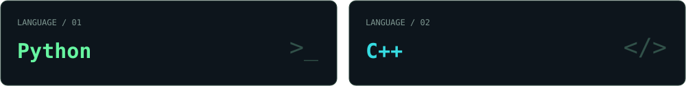
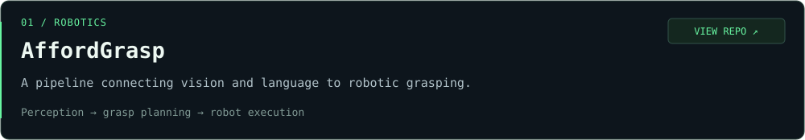
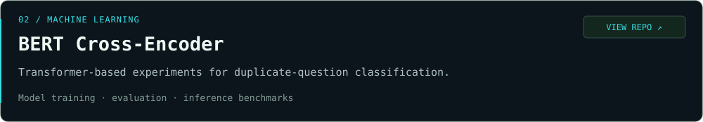

  

### `$ whoami`

Hi, I'm **Yuchan**, an undergraduate at **UNIST**.

I'm interested in **AI, Computer Vision, and Robotics**, especially how intelligent systems perceive and interact with the physical world.

- **AI** — learning from data and exploring intelligent systems.
- **Computer Vision** — understanding visual information.
- **Robotics** — connecting perception with physical action.

### `$ cat stack.yml`

### `$ ls ~/projects`

### `$ ./connect`

[GitHub / @Yuanzk7](https://github.com/Yuanzk7)

---

`yuchan@workspace:~$` **Thanks for stopping by.**
